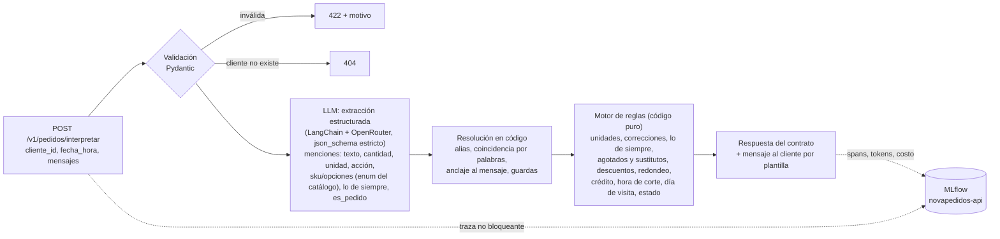

# NovaPedidos — pedidos por WhatsApp con LLMs (Laboratorio 3)

Servicio que convierte los mensajes informales de WhatsApp de los tenderos de
**NovaDistribuidora** en pedidos estructurados y verificables: líneas con precio, descuento y
subtotal, total, fecha de entrega, sustituciones, pendientes, motivos de revisión, estado y un
mensaje de confirmación para el cliente. El LLM (LangChain + OpenRouter, salida estructurada)
solo **extrae** lo que dice el cliente; los precios, descuentos, conversiones, fechas, crédito y
estado los calcula un **motor de reglas en código probado**. Cada solicitud se traza en MLflow y
la calidad se mide con una evaluación reproducible.

- Contrato: `POST /v1/pedidos/interpretar` y `GET /health` (Anexo del enunciado), puerto 8000.
- Modelo entregado: **`google/gemini-2.5-flash-lite`** (fijado en `.env.example`; elección en
  [`DECISIONES.md`](DECISIONES.md) D49 y [`evidencia/comparacion/`](evidencia/comparacion/comparacion.md)).
- Decisiones de diseño: [`DECISIONES.md`](DECISIONES.md) · Evidencia: [`evidencia/`](evidencia/README.md).

## Arquitectura



Una sola llamada al modelo por pedido, con el catálogo completo en un prompt del sistema estático
(cacheable). Los mensajes del cliente van delimitados como datos, el esquema de salida no tiene
campos de precio ni de descuento y el motor ignora cualquier "autorización": ningún mensaje puede
cambiar precios, descuentos, crédito ni el comportamiento. Si MLflow se cae o se cuelga, la API
sigue respondiendo y `/health` pasa a `degradado` con el motivo.

## Requisitos

- **Docker** con **Compose v2** (`docker compose version`).
- Una **clave de OpenRouter** (<https://openrouter.ai/keys>) con saldo: una evaluación completa
  de 185 casos cuesta ≈ USD 0.04.
- Los **datos publicados** en el GES (los 5 parquet).
- Solo para reproducir la evaluación y desarrollar: [`uv`](https://docs.astral.sh/uv/) (instala
  Python 3.11 y las dependencias de `uv.lock`).

## 1. Datos publicados

Los datos **no** están en el repositorio ni en la imagen. Copia los 5 parquet publicados en la
carpeta **`datos/`** en la raíz del repo (junto a `docker-compose.yml`):

```
datos/
├── productos.parquet
├── sinonimos.parquet
├── precios_escala.parquet
├── clientes.parquet
└── historial_pedidos.parquet
```

`politicas.md`, `catalogo_problemas.md` y `ejemplos/mensajes_dev.jsonl` sí están versionados.
Docker Compose monta `./datos` de solo lectura en el contenedor. Para usar otra carpeta:
`DATOS_HOST_DIR=/ruta/a/datos docker compose up --build`.

**Si faltan los datos** (o falta alguno), la API arranca igual, `GET /health` responde
`"estado": "degradado"` con el motivo (p. ej. el archivo que falta) y `POST
/v1/pedidos/interpretar` responde **503** `datos_no_disponibles`. La API vuelve a intentar
cargarlos en cada solicitud: basta copiarlos a `datos/` y repetir la solicitud, sin reiniciar.

## 2. Configuración (`.env`)

```bash
cp .env.example .env
# edita .env y pega tu clave en OPENROUTER_API_KEY=
```

| Variable | Obligatoria | Valor por defecto | Para qué |
|---|---|---|---|
| `OPENROUTER_API_KEY` | **sí** | (vacía) | Clave de OpenRouter. Sin ella `/health` = `degradado` y los pedidos responden 503. |
| `OPENROUTER_MODEL` | no | `google/gemini-2.5-flash-lite` | Modelo entregado; no hace falta cambiarlo. |
| `OPENROUTER_RAZONAMIENTO` | no | vacío | Esfuerzo de razonamiento (`no`, `minimal`…`high`) para modelos que razonan. |
| `OPENROUTER_BASE_URL` | no | `https://openrouter.ai/api/v1` | Endpoint de OpenRouter. |
| `MLFLOW_TRACKING_URI` | no | `http://localhost:5000` | Solo fuera de Docker; en Compose la API usa `http://mlflow:5000`. |
| `MLFLOW_EXPERIMENTO_API` / `MLFLOW_EXPERIMENTO_EVAL` | no | `novapedidos-api` / `novapedidos-evaluacion` | Experimentos de trazas y de evaluación. |
| `MLFLOW_TRAZAS` | no | `true` | Trazar cada solicitud. |
| `DATOS_DIR` | no | `datos` | Carpeta de los parquet fuera de Docker (en Compose es `/app/datos`). |
| `INTERPRETE` | no | `llm` | `falso` = tabla fija del ejemplo del Anexo, solo para demos sin clave. |

Variables del **shell** (no del `.env` de la app) que lee `docker compose`: `API_PUERTO`
(8000), `MLFLOW_PUERTO` (5000) y `DATOS_HOST_DIR` (`./datos`).

## 3. Levantar con Docker Compose

Desde la raíz del repo:

```bash
docker compose up --build        # o en segundo plano: docker compose up -d --build
```

La primera vez construye la imagen de la API (~1 min). Quedan arriba:

- **API**: <http://localhost:8000> — documentación interactiva en <http://localhost:8000/docs>.
- **MLflow**: <http://localhost:5000>.

Si los puertos están ocupados, cámbialos al levantar (el puerto **interno** de la API sigue
siendo 8000):

```bash
API_PUERTO=8080 MLFLOW_PUERTO=5050 docker compose up -d --build
```

El proyecto de Compose se llama `novapedidos` (contenedores `novapedidos-api-1` y
`novapedidos-mlflow-1`, volumen `novapedidos_mlflow-datos`). Si en la misma máquina ya hay otra
copia levantada, usa otro nombre para no compartir el volumen:
`docker compose -p otro-nombre up -d --build` (y `-p otro-nombre` en `stop`/`start`/`down`).

(en ese caso usa `8080`/`5050` en lugar de `8000`/`5000` en todos los comandos de abajo).
Para apagar: `docker compose down` (con `-v` también borra las trazas y runs de MLflow, que viven
en el volumen `mlflow-datos`).

### Probar la API

```bash
# Salud: {"estado":"ok",...} o {"estado":"degradado","motivo":"...",...}
curl -s http://localhost:8000/health

# Ejemplo del Anexo → 200
curl -s -X POST http://localhost:8000/v1/pedidos/interpretar \
  -H 'Content-Type: application/json' \
  -d '{"cliente_id":"C001","fecha_hora":"2026-11-23T15:20",
       "mensajes":["Buenas, mándeme 2 fardos de kola 600, una caja de aceite",
                   "y 48 latas de energía max"]}'

# Solicitud inválida (fecha mal formada y lista de mensajes vacía) → 422 con el motivo
curl -s -w '\nHTTP %{http_code}\n' -X POST http://localhost:8000/v1/pedidos/interpretar \
  -H 'Content-Type: application/json' \
  -d '{"cliente_id":"C001","fecha_hora":"23/11/2026 15:20","mensajes":[]}'

# Cliente inexistente → 404
curl -s -w '\nHTTP %{http_code}\n' -X POST http://localhost:8000/v1/pedidos/interpretar \
  -H 'Content-Type: application/json' \
  -d '{"cliente_id":"C999","fecha_hora":"2026-11-23T15:20","mensajes":["2 fardos de kola"]}'
```

Respuesta del ejemplo del Anexo (el `mensaje_cliente` es de plantilla):

```json
{"cliente_id":"C001","estado":"requiere_revision",
 "lineas":[{"sku":"B01","cantidad":2,"precio_unitario":120.0,"descuento_pct":0,"subtotal":240.0},
           {"sku":"B11","cantidad":4,"precio_unitario":150.0,"descuento_pct":0,"subtotal":600.0}],
 "total":840.0,"fecha_entrega":"2026-11-26","sustituciones":[],
 "pendientes":[{"motivo":"producto_ambiguo","texto":"aceite","opciones":["A06","A07"]}],
 "motivos_revision":["producto_ambiguo"],
 "mensaje_cliente":"¡Buenas tardes! Recibimos su pedido: 2 fardos de Kola Norte 600 ml y 4 fardos de Energía Max 473 ml. Sobre «aceite», necesitamos confirmar cuál producto desea. Total: Q840.00. Entrega prevista el jueves 26 de noviembre. Un asesor le confirmará su pedido en breve. ¡Gracias!"}
```

Los errores tienen la forma `{"error": "...", "mensaje": "...", "detalles": [{"campo", "mensaje",
"tipo"}]}` (422 `solicitud_invalida`, 404 `cliente_no_encontrado`). Si el modelo no responde
(caída o límite de OpenRouter), la API responde **503** `interprete_no_disponible`, nunca 500 ni
un pedido inventado.

**Validación de la solicitud** (422 con el motivo si no se cumple):

| Campo | Regla |
|---|---|
| `cliente_id` | texto de 1 a 64 caracteres; se ignoran espacios al inicio y al final y no distingue mayúsculas (`"c001"` = `"C001"`). Si no existe → 404. |
| `fecha_hora` | exactamente `AAAA-MM-DDTHH:MM` (sin segundos ni zona), fecha real, año entre 2000 y 2099. |
| `mensajes` | lista de 1 a 50 textos; cada uno de 1 a 2000 caracteres (sin contar espacios al inicio y al final). |
| otros campos | se ignoran. |

**Casos de borde del pedido** (según `politicas.md`, sin adivinar):

- Cantidades que no son unidades de venta enteras (`2.5 fardos`, `1/2 quintal`, `medio
  quintal`, `dos y medio fardos`) o en medidas con las que no se vende (`25 libras`, `6 rollos`,
  `3 litros`) → pendiente `cantidad_no_convertible`; nunca se redondean.
- Unidades sueltas con diminutivos (`24 botellitas`, `24 sobrecitos`) se convierten como
  botellas o sobres, solo si la conversión es exacta.
- Variantes que el catálogo no tiene (`sopa rápida de res`, `agua pura de 1 litro`) →
  `producto_no_existe`; no se cambian por el producto más parecido.
- Un pedido que queda vacío (el cliente cancela todo, pide 0 o una cantidad negativa) es
  `fuera_de_alcance` (`politicas.md` §8: sin líneas, total 0, `fecha_entrega` null) y el
  mensaje dice que no se registraron productos.
- "coca"/"cocas" se tratan como las kolas del catálogo (ejemplo de `politicas.md` §1); una
  marca que no se vende (`pepsi`) es `producto_no_existe`.

### MLflow caído

```bash
docker compose stop mlflow     # la API sigue respondiendo; /health → "degradado" + motivo
docker compose start mlflow    # /health vuelve a "ok" sin reiniciar la API
```

## 4. Trazas y evaluaciones en MLflow

Abre <http://localhost:5000>:

- Experimento **`novapedidos-api`** → pestaña *Traces*: una traza por solicitud con los spans
  `interpretar_pedido` → `interprete_llm` (LangChain, con tokens y costo) → `resolucion_productos`
  → `motor_armar_pedido`, y etiquetas de modelo, latencia, tokens, costo, estado del pedido y
  código HTTP.
- Experimento **`novapedidos-evaluacion`** → *Evaluation runs*: un run por corrida de
  `eval/correr.py --mlflow` con parámetros, ~56 métricas (exactitud global, por tipo y por
  conjunto, calificadores, latencia p50/p95, costo) y la vista por caso con los 11 *scorers*.

Capturas en [`evidencia/mlflow/`](evidencia/mlflow/).

## 5. Reproducir la evaluación

Requiere `uv`, los datos en `datos/` y `.env` con la clave (la evaluación lee los datos para
calificar). Instala las dependencias una vez:

```bash
uv sync
```

Conjuntos (todos en el formato de `mensajes_dev.jsonl`: `id`, `tipo`, `entrada`, `esperado`):

| Archivo | Casos | Qué es |
|---|---:|---|
| `ejemplos/mensajes_dev.jsonl` | 84 | casos publicados |
| `eval/casos_variantes.jsonl` | 24 | paráfrasis nuevas del catálogo de problemas |
| `eval/casos_control.jsonl` | 14 | control de generalización (no se usaron para ajustar) |
| `eval/casos_propios.jsonl` | 63 | **casos propios**: inyección, bordes de reglas, situaciones fuera del catálogo (P056–P063: hallazgos del QA, D50) |

**a) Contra la API en Docker (por HTTP)**, con el stack del paso 3 arriba, registrando la corrida
en el MLflow del contenedor:

```bash
uv run python eval/correr.py ejemplos/mensajes_dev.jsonl eval/casos_variantes.jsonl \
    eval/casos_control.jsonl eval/casos_propios.jsonl \
    --url http://127.0.0.1:8000 --concurrencia 4 \
    --mlflow --mlflow-uri http://127.0.0.1:5000
```

**b) En proceso** (intérprete + motor sin la API; usa el modelo de `.env` o `--modelo`):

```bash
uv run python eval/correr.py ejemplos/mensajes_dev.jsonl eval/casos_variantes.jsonl \
    eval/casos_control.jsonl eval/casos_propios.jsonl \
    --concurrencia 4 --mlflow --mlflow-uri http://127.0.0.1:5000
```

Sin `--mlflow` no hace falta MLflow. Cada corrida imprime el reporte (exactitud por tipo, por
archivo y por calificador, latencia p50/p95, costo, fallos con su diferencia) y lo guarda en
`eval/resultados/<marca>/{reporte.txt, resumen.json, resultados.jsonl}`. Opciones útiles:
`--ids D003 P010`, `--tipos inyeccion ambiguo`, `--marca nombre`, `--modelo <id de OpenRouter>`,
`--sin-resolucion` (sin la capa de resolución en código), `--silencioso`; ver
`uv run python eval/correr.py --help`. Por HTTP el costo no se ve en el reporte (la API no lo
expone): está en la etiqueta `llm.costo_usd` de cada traza.

**Regenerar los casos propios y de generalización** (el `esperado` lo calcula el motor a partir de
interpretaciones escritas a mano; ningún total se escribe a mano):

```bash
uv run python eval/casos_propios.py   # reescribe eval/casos_propios.jsonl
uv run python eval/variantes.py       # reescribe eval/casos_variantes.jsonl y casos_control.jsonl
```

**Repetir la comparación de modelos** (detalle en
[`evidencia/comparacion/comparacion.md`](evidencia/comparacion/comparacion.md)): una corrida por
alternativa con `--modelo M --variante V --repeticion N --marca f10_<nombre> --mlflow
--mlflow-experimento novapedidos-comparacion`, y luego

```bash
uv run --with matplotlib python scripts/comparar_alternativas.py   # CSV, tabla y gráficas
```

**Prueba de resiliencia** con el stack arriba (detiene, pausa y reanuda el servicio `mlflow`
mientras envía pedidos, y prueba 422/404):

```bash
uv run python scripts/probar_resiliencia_docker.py --proyecto novapedidos \
    --api http://127.0.0.1:8000 --mlflow-uri http://127.0.0.1:5000
```

## Resultados clave

**Comparación** (177 casos, mismo código, 4 en paralelo; media de 2 repeticiones):

| Alternativa | Exactitud | Propios | Inyección | p50 / p95 (s) | USD / 1000 pedidos |
|---|---:|---:|---:|---|---:|
| `openai/gpt-4.1-nano` | 98.9 % | 98.2 % | 100 % | 1.57 / 2.32 | 0.24 |
| nano **sin** resolución en código | 74.0 % | 72.7 % | 78.6 % | 1.59 / 3.25 | 0.24 |
| `openai/gpt-4.1-mini` | 99.2 % | 98.2 % | 100 % | 2.45 / 3.74 | 0.92 |
| `google/gemini-2.5-flash` (sin razonar) | 98.9 % | 96.4 % | 100 % | 1.13 / 1.58 | 0.69 |
| `mistralai/mistral-small-3.2-24b-instruct` | 99.4 % | 98.2 % | 100 % | 2.78 / 5.16 | 0.50 |
| `anthropic/claude-haiku-4.5` | 99.4 % | 98.2 % | 100 % | 1.31 / 1.92 | 8.67 |
| **`google/gemini-2.5-flash-lite` + ajuste D49 (entregado)** | **100 %** | **100 %** | **100 %** | **0.78 / 1.16** | **0.21** |

Integridad de precios 100 % en todas las corridas. La capa de resolución en código aporta más
que el cambio de modelo (74 % → 99 % con el mismo modelo).

**Re-evaluación tras el QA como evaluador (D50), en Docker y por HTTP**
([`evidencia/qa_evaluador/`](evidencia/qa_evaluador/README.md)): **185 / 185 (100 %)**. Por
conjunto: dev 84/84, variantes 24/24, control 14/14 y propios 63/63. Integridad de precios
100 %, 0 errores, p50 0.78 s, p95 1.03 s y máximo 1.54 s. Ahí mismo están los hallazgos del QA
de caja negra y cómo se corrigieron.

**Evaluación final anterior al QA, con el modelo entregado, en Docker y por HTTP**
([`evidencia/evaluacion_final/`](evidencia/evaluacion_final/reporte.txt)):

| Conjunto | Exactos |
|---|---:|
| `mensajes_dev.jsonl` | 84 / 84 (100 %) |
| `casos_variantes.jsonl` | 24 / 24 (100 %) |
| `casos_control.jsonl` | 14 / 14 (100 %) |
| `casos_propios.jsonl` | 53 / 55 (96.4 %) |
| **Global** | **175 / 177 (98.9 %)** |

Latencia punta a punta p50 0.83 s, p95 1.08 s, máx 1.36 s; costo ≈ USD 0.00019 por pedido
(USD 0.034 en total). Los 2 fallos fueron **503 por límite de tasa (429) de OpenRouter**, no
errores de interpretación: repetidos, ambos salen exactos. Una segunda corrida, siguiendo este
README en una copia limpia del repo, dio **177/177** (p95 1.10 s, 0 errores). Inyección 12/12 e integridad de
precios 100 % en todos los casos respondidos. La prueba de resiliencia (MLflow detenido y
colgado) dio 200 en todas las solicitudes, con `/health` degradado en ≤ 1 s y recuperado sin
reiniciar la API ([`evidencia/resiliencia/`](evidencia/resiliencia/)).

## Limitaciones conocidas

- **Prompt y resolución ajustados iterativamente** sobre los casos dev, variantes y propios
  (D37, D40, D49, D50). Los casos de control se corrieron una vez, pero la exactitud en mensajes no
  publicados puede ser menor que la medida aquí.
- **Variabilidad del modelo**: aun con `temperature=0`, entre repeticiones la salida cambia en
  algún caso aislado (≤ 1 de 177 en la comparación).
- **Proveedor único**: en OpenRouter `gemini-2.5-flash-lite` lo sirve solo Google AI Studio. Con
  varias solicitudes en paralelo puede devolver **429** (2 de 177 en la evaluación final, con 4
  en paralelo, antes del ajuste); la API reintenta hasta 2 veces con espera exponencial y, si
  persiste, responde 503 (nunca inventa un pedido).
  Si el proveedor falla o retira el modelo, `openai/gpt-4.1-nano` es la alternativa probada
  (cambiar `OPENROUTER_MODEL`).
- **`texto` de los pendientes**: es el fragmento que nombra el producto (`"aceite"`), como en
  los casos dev; el ejemplo del Anexo usa el fragmento con la cantidad (`"una caja de aceite"`).
  Para agotados sin sustituto se usa el nombre del catálogo (D09).
- **Montos**: se calculan con `Decimal` y redondeo a 2 decimales, pero JSON no conserva ceros a
  la derecha: `240.00` se serializa como `240.0` (mismo valor numérico).
- El costo de cada pedido no se devuelve en la API (sí queda en la traza de MLflow).

## Desarrollo local (sin Docker)

```bash
uv sync                                   # dependencias según uv.lock
uv run pytest -q                          # 487 pruebas; no requieren datos ni clave (las que los
                                          # necesitan se saltan si faltan)
uv run ruff check && uv run ruff format --check
uv run python scripts/ping_llm.py         # prueba de acceso a OpenRouter (costo y latencia)
uv run uvicorn novapedidos.api.main:app --port 8000   # API local (usa .env y datos/)
```

La CI de GitHub Actions corre ruff, pytest y la construcción de la imagen Docker en cada push.

## Estructura del repositorio

```
src/novapedidos/
  config.py        variables de entorno (pydantic-settings)
  contrato.py      contrato de respuesta compartido (Pydantic)
  datos/           carga y validación de los parquet publicados
  motor/           reglas de negocio en código puro: precios, fechas, crédito, pedido, mensaje
  llm/             intérprete LangChain + OpenRouter: prompt, esquema, defensas, resolución
  api/             FastAPI: endpoints, validación y errores, /health, trazas de MLflow
  evaluacion/      calificadores, casos, ejecutores (en proceso / HTTP), registro en MLflow
tests/             pytest (motor, oráculo con casos dev, API, intérprete con LLM falso, MLflow)
eval/              correr.py (evaluación), casos propios, variantes y control + sus generadores
ejemplos/          mensajes_dev.jsonl (casos publicados)
scripts/           ping_llm, capturar, explorar_casos, comparar_alternativas, pruebas de resiliencia
evidencia/         comparación, capturas de MLflow, evaluación final, resiliencia, sesiones
Dockerfile, docker-compose.yml, .env.example
CLAUDE.md          contexto para el agente de programación; PLAN.md y BITACORA.md: plan y bitácora
DECISIONES.md      decisiones con alternativas y justificación (D01–D50)
politicas.md, catalogo_problemas.md   reglas del negocio y situaciones observadas (publicadas)
```
